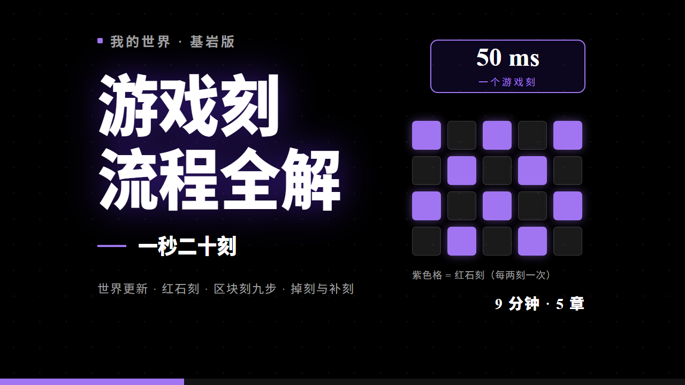

# bedrock gametick video

> 一秒二十刻：我的世界基岩版游戏刻流程全解

一条 9 分钟的科普视频，把 Minecraft 基岩版的 **tick（游戏刻）流水线** 从头拆到尾：
50 毫秒一圈到底发生了什么、世界更新有哪些步骤、区块刻的九步怎么排、红石刻为什么"慢半拍"、
服务器卡顿时它又在补什么。

全片画面由 **Remotion** 用代码逐帧绘制（无素材剪辑），配音为 **GPT-SoVITS** 本地微调克隆音色。



**成品**：[9 分钟 MP4 下载](https://github.com/FeixiangTMC/bedrock-gametick-video/releases/latest)

## 制作

| 项 | |
|---|---|
| 视频制作 | **deepseek** |
| 制作工具 | anything2explainer（主题 → 讲解视频的流水线） |
| 配音 | GPT-SoVITS v2（本地微调，8 分钟素材） |
| 画面 | Remotion 代码动画，55 个镜头逐帧绘制 |

## 内容结构

| 章 | 起点 | 讲什么 |
|---|---|---|
| 二十步一秒 | 0:03 | 刻的定义、20 TPS / 50 ms、MSPT、线程睡眠 `50 − MSPT`、补刻、暂停只停世界 |
| 世界更新 | 2:08 | 刷怪配额 → 洗牌 → 时间管理器 → 维度 → 常加载区 → 玩家 → 实体 → 存档 → 服务端附加更新 |
| 红石刻 | 4:42 | 红石求值三步 → 加锁放出 → 两刻一次 → 半拍 → 检查名单 → 中继器档位 → 收尾 |
| 区块刻九步 | 6:05 | 刷怪 / 环境 / 随机刻 / 普通计划刻 / 随机计划刻 / 实体标记 / 方块实体 / 应用红石 / 保存计时 |
| 掉刻与补刻 | 7:52 | 预算够不够、补跑、异常、优化的三条做法 |

## 技术栈

- **画面**：Remotion 4.0 + React 19 + TypeScript，1280×720 / 30 fps
- **配音**：GPT-SoVITS v2ProPlus（本地微调，8 分钟素材），或任意 edge-tts 音色
- **字幕 / 时间轴**：由实际音轨逐句生成，帧级对齐
- **封面**：同一套 Remotion 图元渲染（`src/Cover.tsx`）

## 目录

```
src/
  Root.tsx           合成注册（Video / Cover / 各组预览）
  Main.tsx           Stage：背景 → 镜头 → 进度条 → 字幕
  config.ts          片级配置（HUD 章节、配色、尺寸）
  Cover.tsx          B 站封面
  common/            timeline / subs（自动生成）、进度条、字幕、背景
  shots/G1..G8/      55 个镜头，一段解说词一个镜头
script/
  narration.txt      解说词（空行分段 = 镜头边界）
  timeline.json      逐句时间轴（自动生成）
  timeline.md        分镜表（自动生成）
scripts/
  tts_build.py       配音 + 时间轴 + 字幕生成
  a2e.mjs            doctor / new / tts / still / preview / render
docs/                封面图
research/            资料摘录
```

## 复现

```bash
npm install

# 1) 生成配音与时间轴（需要配一个 TTS 引擎）
TTS_ENGINE=edge python scripts/tts_build.py        # 云端，最快
# 或 TTS_ENGINE=gsv 配合本地 GPT-SoVITS 服务（见脚本头部注释）

# 2) 出图 / 渲染
node scripts/a2e.mjs still Cover 1 out cover        # 封面
node scripts/a2e.mjs preview Video 900 300          # 预览一段
node scripts/a2e.mjs render v1                      # 整片
```

`script/narration.txt` 是唯一的内容源：改文字 → 重跑 `tts_build.py` → 时间轴、字幕、镜头帧号都会自动重排。

## 资料与致谢

- 机制细节主要依据 [Minecraft Wiki](https://minecraft.wiki/)（CC BY-NC-SA 3.0），摘录见 `research/`。
- 字体：Noto Sans SC、Exo 2、Orbitron、Audiowide（SIL Open Font License，见 `public/fonts/LICENSE.md`）。

## 许可

- **代码**（`src/`、`scripts/`）：MIT
- **视频内容与文案**（成片、`script/narration.txt`、封面）：CC BY-NC-SA 4.0

Minecraft 是 Mojang Studios 的商标，本项目为非官方爱好者作品，与 Mojang / Microsoft 无关联。
